# Flux GitOps Playground

A small, live Kubernetes cluster that is run entirely from this repository by [Flux](https://fluxcd.io).
It's for people who have used GitOps from the developer side (push an image, it gets deployed) and
want to see the platform side: what Flux actually does, how image automation turns a new tag into a
Git commit, and how a shared cluster keeps several people out of each other's way.

If you've been invited, you get:

- a login to the cluster with **your GitHub account** (no keys or passwords to look after), for
  `kubectl` and the `flux` CLI
- **read-only access to everything**, so you can poke around Flux's own objects
- **your own namespace** `play-<you>` and folder `tenants/<you>/`, where your PRs merge without review
- **a release button** that publishes a new version of a demo app, which Flux then rolls out to
  `https://<you>.gitops.shtev.dev` all by itself

## Getting started

1. Accept the invitation to the [`shtev-gitops-playground`](https://github.com/shtev-gitops-playground) GitHub org.
2. Follow [docs/setup.md](docs/setup.md) to install `kubectl` and `flux` and log in (WSL, Linux or macOS).
3. Work through [docs/exercises.md](docs/exercises.md). [docs/how-it-works.md](docs/how-it-works.md)
   explains each moving part when you want the detail.

> This repo is public, so your GitHub username will appear in it (in your folder name and permissions)
> and in your PRs.

## How it fits together

**Deploying.** Flux pulls this repo and makes the cluster match it:

<picture>
  <source media="(prefers-color-scheme: dark)" srcset="docs/diagrams/deploying-dark.svg">
  
</picture>

**Releasing.** A new image tag turns into a Git commit, and then the loop above deploys it:

<picture>
  <source media="(prefers-color-scheme: dark)" srcset="docs/diagrams/releasing-dark.svg">
  
</picture>

**Logging in.** Your GitHub account becomes a Kubernetes user:

<picture>
  <source media="(prefers-color-scheme: dark)" srcset="docs/diagrams/logging-in-dark.svg">
  
</picture>

- **Terraform** (`infra/`) builds what Flux needs to exist first: the server, DNS, the GitHub repo
  and its rules, and Flux itself.
- **Flux** does everything after that, from this repo: cert-manager, Dex, permissions, and every
  player's namespace and app.

## What's where

| Path | What | Who changes it |
|---|---|---|
| `clusters/playground/` | Flux's entry point: what to sync, in what order | Steve |
| `infrastructure/` | Platform: cert-manager, Dex, permissions, image automation, policies | Steve |
| `platform/tenants/<you>/` | Your namespace, permissions and Flux syncs | Steve |
| `tenants/<you>/app/` | **Your app**: anything here is applied into `play-<you>` | **You** |
| `tenants/<you>/images/` | **Your ImagePolicy**: which of your releases to run | **You** |
| `apps/demo-app/` | The demo app's source | Steve |
| `infra/` | Terraform | Steve |
| `kubeconfig/playground.yaml` | The kubeconfig you use (no secrets in it) | Steve |
| `scripts/` | Tool installer, onboarding, checks and their tests | Steve |

## For the operator

[docs/operator.md](docs/operator.md) covers building it from scratch, adding and removing players,
rotating credentials, and tearing it down.
